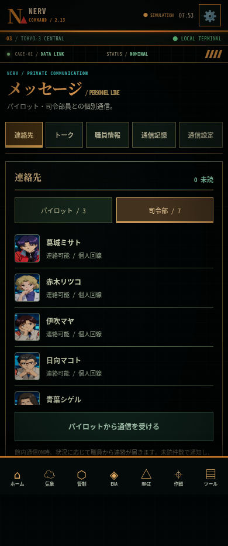
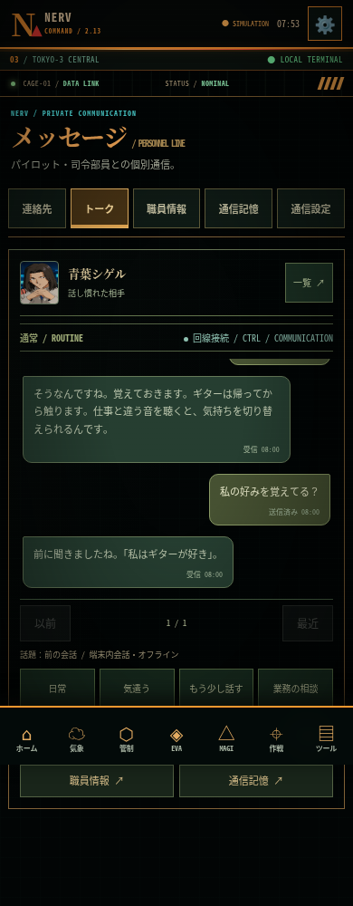
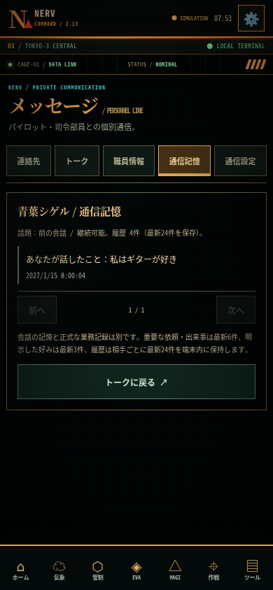
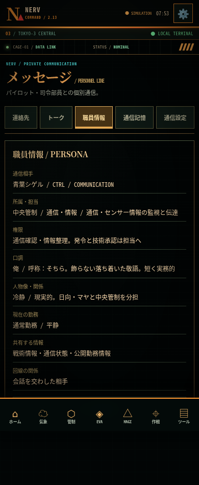
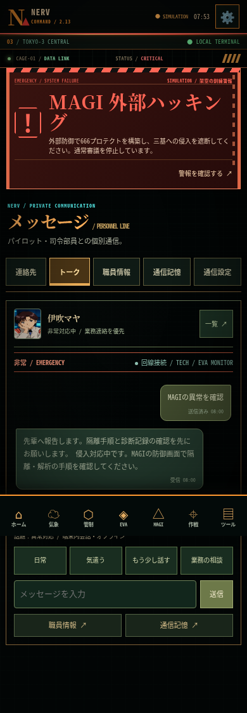
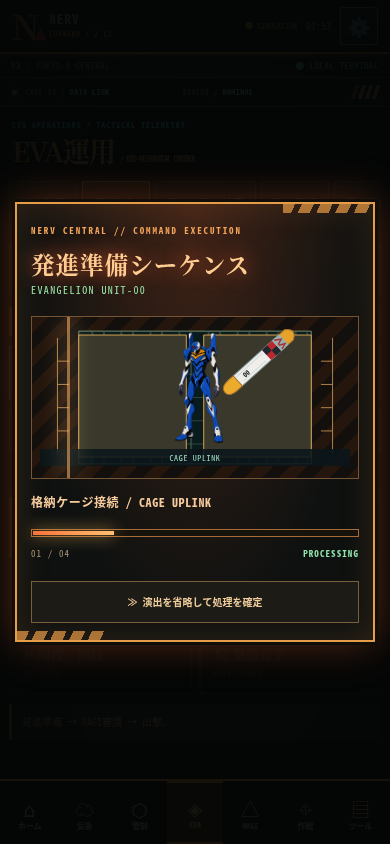
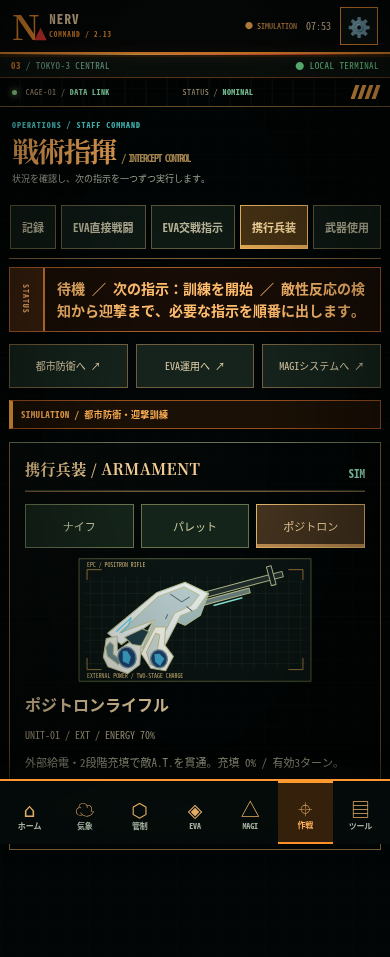
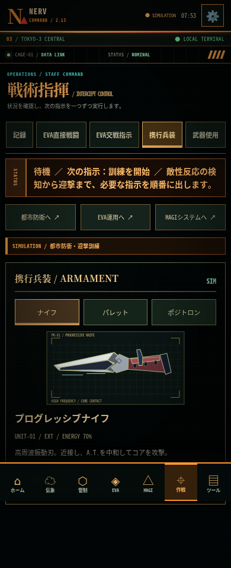

# v2.22 / 兵装ビル・地図・兵装フィット

オフラインChromiumの実際の模擬状態。兵装ビル/地図390px、装備430px。iPhone実機写真ではありません。原画像は全て固定し、兵装ビルの参考画だけを別素材で追加。

- [兵装ビル選択](v222-batteries.png) / [切れを修正した防衛盤](v222-map.png) / [フィットした兵装](v222-equipment.png)

以下は履歴。

# v2.21 / 使徒修復・作戦通信

オフラインChromiumで実際の模擬状態を撮影。資料室390px、通信履歴/戦闘430px。iPhone実機の写真ではありません。人物・EVA・兵装・施設・市街は固定。使徒だけを新しい修復アトラスへ切替。

- [使徒資料](v221-dossier.png) / [受領通信の履歴](v221-journal.png)
- [戦闘の受信通知](v221-radio.png) / [ラミエル戦・陽電子充填](v221-charge.png)

以下は過去版の見本です。

# v2.20 / 透過兵装・管制UI

390pxのオフラインChromium（戦闘は430px）。実際の模擬状態。固定画像は維持、iPhone実機の写真ではありません。

- [ホーム](v220-home.png) / [機能検索・移動](v220-menu.png)
- [MAGI三基管制](v220-magi.png) / [666進行中](v220-666.png)
- [透過兵装](v220-weapon.png) / [2AP戦闘](v220-battle.png)

以下は過去版の見本です。

# v2.19 / 統合管制

390pxのオフラインChromium、実際の模擬状態。固定画像は維持。iPhone実機の写真ではありません。

- [2AP戦闘](v219-battle.png)：固定市街背景・EVA・使徒、敵の予告範囲、移動/戦闘/守備。
- [MAGI三基と経路操作](v219-magi.png) / [666対応](v219-666.png)：独立測定、経路パッチ、演算配分。

以下は旧版の見本です。

# v2.18 / 精密な市街背景画像

390pxのオフラインChromium。新規背景画と実際の模擬状態を撮影。固定画像は維持、実機写真ではありません。

- [通常](v218-city-normal.png) / [砲塔展開](v218-city-armed.png) / [装甲収容](v218-city-sheltered.png)
- [俯瞰地図](v218-city-map.png)
- [戦闘](v218-battle.png) / [命中](v218-battle-hit.png)

以下は旧版の見本です。

# v2.17 / 手動戦術盤・Canvas市街

390pxのオフラインChromiumで撮影。固定画像は維持。実機写真ではありません。

- [出撃後の戦術盤](v217-field.png)：赤い攻撃予告、遮蔽、移動、照準。
- [ナイフ命中](v217-knife.png) / [陽電子狙撃](v217-positron.png)：保存成功後の実ダメージとCanvas描画。
- [市街眺望](v217-streets.png) / [都市地図](v217-city.png)：SVG表示なし。施設損傷・砲台・収容は共通状態。
- [Canvasフォールバック](v217-fallback.png)：WebGLなしでも戦術盤を利用可能。

以下は旧版の参考です。

# v2.16 戦闘専用画面・兵装ビル・演出設定

390pxのオフラインChromiumで現行ビルドを撮影。実機写真ではありません。既存の人物・兵装・施設画像は維持。画面内の敵HP、担当機、承認、充填、砲台配備は撮影時の実際の模擬状態です。

| 画面 | 内容 |
| --- | --- |
| [交戦・攻撃可能](v216-battle-ready.png) / [命中後](v216-battle-hit.png) | 共通ナビと分離した戦闘画面、次の一操作・武器名付き攻撃 |
| [担当機・三基審議](v216-battle-setup.png) / [使徒監視](v216-battle-targets.png) | 出撃準備と同じ保存を使う独立した区画 |
| [ラミエル・陽電子狙撃](v216-battle-ramiel.png) | 外部給電・二段階充填・現ターン承認を確認済み |
| [省電力のSVG表示](v216-battle-fallback.png) | GPU表示なしでも戦闘操作を維持 |
| [兵装ビルと住宅街](v216-city-streets.png) / [防衛地図](v216-city-map.png) | 添付参考の外装・多連砲身・住宅・電線を追加 |
| [演出速度](v216-motion.png) | 0.5× / 1× / 1.5×、業務や戦闘の時間は変えない |

以下は旧版の見本です。

---

# v2.15 都市・使徒・保安捜査・MAGI保守の画面見本

2026-10-20（日本時間）、390pxのオフラインChromiumで現行ビルドを撮影。実機写真ではありません。固定ナビがフルページ撮影の途中へ写る場合があります。既存の人物・兵装・施設画像は維持しています。

| 画面 | 内容 |
| --- | --- |
| [第三新東京市](v215-city.png) / [使徒接近中](v215-city-battle.png) | 湖・山並み・71棟の市街地、実状態と施設選択 |
| [使徒監視](v215-angels.png) / [ラミエル交戦管制](v215-ramiel-engagement.png) | 3使徒、装備・担当機・次の準備・武器名付き攻撃 |
| [MAGI保守](v215-magi-clock.png) / [補正操作](v215-clock-tools.png) | 独立診断と実際の各基偏差の調整 |
| [現場捜査](v215-fieldwork.png) / [現場記録](v215-records.png) | 映像・回線・巡回の照会と結果 |
| [区画制御](v215-route-control.png) / [解決手配](v215-response.png) | 経路描画・照合、保留・隔離・同行・部署引継ぎ |
| [発生頻度](v215-cadence.png) | 通常勤務・低頻度・集中演習と自動監視 |

以下は旧版の見本です。固定素材・既存機能の継続確認に使用します。

---

# v2.14 AI通信・保安・兵装・MAGIの画面見本

2026-10-18、390pxのオフラインChromiumで現行ビルドを撮影。実機写真ではありません。固定ナビがフルページ撮影の途中へ写る場合があります。

| 画面 | 内容 |
| --- | --- |
| [AI設定](v214-messages-ai.png) | ブラウザはオフライン、ScriptableでKeychain設定 |
| [MAGI](v214-magi-system.png) / [警報中](v214-magi-alert.png) | 三基と実状態、Wave Field |
| [司令・副司令](v214-hq-directorate.png) / [ゼーレ](v214-hq-seele.png) | 新顔・指揮系統・監査回線 |
| [ジオフロント眺望](v214-hq-observatory.png) | 固定画像と管制レイヤー |
| [ナイフ](v214-knife.png) / [パレット](v214-rifle.png) / [ポジトロン](v214-positron.png) | 独立WebPの新規精密図、拡大対応 |
| [本部保安](v214-security.png) / [証拠照合](v214-evidence.png) | 実際の保存状態にある案件と3証拠の切替 |

以下は旧版の見本です。固定素材・既存機能の継続確認に使用します。

---

# v2.13 通信システムの画面見本

オフラインChromium、390pxで実際の操作を通して撮影。実機写真ではありません。

| 10人の連絡先 | 状況と記憶を使う会話 | 個別の記憶 |
| --- | --- | --- |
|  |  |  |

| 人格・職務 | 非常通信 | プラグ挿入 |
| --- | --- | --- |
|  |  |  |

| ポジトロン | プログレッシブナイフ |
| --- | --- |
|  |  |

以下は旧版の見本です。既存固定素材と各機能の継続確認に使います。

---

# 現行画面の見本

2026-10-18：v2.12の見本です。390px幅のオフラインChromium・合成保存による撮影で、iPhone実機ではありません。固定された元画像はすべて保持しています。フルページ撮影では固定ナビが途中に写ることがあります。

| v2.12見本 | 内容 |
| --- | --- |
| [ホーム](v212-home-390.png) | 業務・司令部・666・メッセージへ直接移動 |
| [パイロット連絡先](v212-pilot-contacts-390.png) / [司令部連絡先](v212-staff-contacts-390.png) | 固定の顔を使う8人の個別通信 |
| [個人トーク](v212-personal-chat-390.png) | 気遣い・日常・親しい応答、左右の吹き出し・履歴送り |
| [ナイフ](v212-knife-390.png) / [ポジトロン](v212-positron-390.png) | 選択した装備を独自SVGで確認 |
| [射撃準備](v212-positron-ready-390.png) / [命中](v212-positron-hit-390.png) | 実際の送電・充填・承認と、保存後の実損耗 |
| [神経接続](v212-neural-390.png) / [部位報告](v212-damage-report-390.png) | 同じ機体状態を波形と部位別の推定に反映 |
| [戦術地図](v212-tactical-map-390.png) | 実際の進路・距離・座標・被害予測と走査線 |
| [666](v212-666-390.png) / [三基防御](v212-magi-protection-390.png) / [演算波形](v212-magi-streams-390.png) | 同じ三基の侵入圧と防壁状態 |
| [射出シーケンス](v212-launch-390.png) | 固定EVAシート・実際の拘束解除ステップ |

---

2026-10-18：v2.11の見本です。合成保存・オフラインChromium・390px幅・低モーションで撮影し、iPhone実機ではありません。元のEVAとパイロット顔は変更していません。

| v2.11見本 | 状況 |
| --- | --- |
| [ホーム](v211-home-390.png) | 先頭4ボタンから当直・損傷・会話・666へ到達 |
| [日常業務](v211-daily-work-390.png) | 冷却系統点検の受付と処理順 |
| [発令所](v211-hq-bridge-390.png) | WebGL投影の状態と損傷なしの明記 |
| [5人の通信](v211-five-staff-390.png) | 固定の顔、状況報告と受領 |
| [666投影](v211-666-projection-390.png) | 既存の外部侵入訓練への入口と六角投影 |
| [冷却異常](v211-cooling-incident-390.png) | 負荷70%、枝系統隔離中、技術部への診断依頼 |
| [MAGI共有状態](v211-shared-magi-390.png) | 同じ案件に基づく通常審議保留と対応導線 |

---

2026-10-18追加：v2.10の模擬状態を390px幅のオフラインChromiumで撮影しました。iPhone実機ではありません。EVA三機・パイロット顔は引き続き固定です。固定ナビはフルページ撮影の途中に写り込みますが、各操作はスクロールして触れられます。

| v2.10見本 | 状況 |
| --- | --- |
| [EVA交戦指示](v210-mission-engage-390.png) | 接近・A.T.中和・戦術承認後の通常武器選択 |
| [都市武装](v210-infra-weapons-390.png) | 機関砲・誘導弾の配備と選択 |
| [第三新東京市](v210-hq-city-390.png) | 地上眺望と実際の模擬区画HP |
| [ジオフロント](v210-hq-geofront-390.png) | 固定の環境画を本部監視にも利用 |
| [666監視](v210-magi-external-390.png) | 外部プロテクト構築後の遮断状態 |
| [666防御指示](v210-magi-firewall-390.png) | 演算資源と維持・再起動の選択 |
| [職員会話](v210-command-staff-390.png) | 5人の顔、状況に応じた独自の報告 |

以下の元16見本は実装コミット `e98c584753e8f3a2faff26929b9b3ff0826d8a78` をオフラインChromiumで撮影しました。合成保存・模擬データを使用し、iPhone実機のキャプチャではありません。通常390×844px、A.T.の見本は430px幅です。フルページ撮影なので固定ナビが途中へ写り込む場合があります。撮影時刻や一フレームの位置を固定するピクセルテストではなく、機体・配色・情報の優先度・動作状況の見本です。

| 見本 | 状況・確認点 |
| --- | --- |
| [ホーム](home-390.png) | 移動ボタンだけの通常ホーム。大きな警報は発令時のみ |
| [零号機](redraw-unit-0.png) | 青/白の描画、外部給電、細身の輪郭、模擬波形 |
| [初号機](redraw-unit-1.png) | 紫/緑の装甲と頭部、同じ表示比率 |
| [弐号機](redraw-unit-2.png) | 赤/橙の装甲、機体ごとの差 |
| [A.T.](at-field-430.png) | 描画・フィールド・計測リングの中心位置 |
| [気象](weather-390.png) | 現在地優先の構成と未取得表示。実観測値の画面ではない |
| [都市インフラ](infra-390.png) | 通常の防衛地図とタブ |
| [出撃位置・敵](deployment-map.png) | 二機の配置、敵の接近、関連画面へのリンク |
| [MAGI申請](magi-390.png) | 分かりやすい二種類の申請 |
| [MAGI合議](magi-consensus-390.png) | 三基の配置、二対一の承認と理由、横流れSTATUS |
| [MAGI決議中](magi-voting-390.png) | 実際の三基の賛否を段階表示する演出 |
| [MAGI侵食中](magi-intrusion-390.png) | 整合した警報、侵食率、侵食したコア、選択肢の効果 |
| [MAGI封じ込め](intrusion-contained.png) | 封じ込め後の正常状態と結果表示 |
| [戦術指揮](mission-390.png) | 次の指示と実行条件への導線 |
| [職員支援](tools-390.png) | 目的別の6機能への入口 |
| [端末設定](settings-390.png) | 音・動きの設定 |

元のユーザー添付を、このディレクトリへ保存したものではありません。再描画の共通素材は [eva_units_redrawn.png](../../assets/eva_units_redrawn.png)、方針は [ART_DIRECTION.md](../../docs/ART_DIRECTION.md) にあります。従来のリポジトリ直下 `previews/` は過去版であり、現行の機体品質の基準にはしないでください。

## 職員端末の追加見本（2026-10-17）

今回のオフラインChromium回帰で撮影しました。合成状態を使い、実機画像ではありません。EVAの元の見本と素材は維持しています。

| 見本 | 確認点 |
| --- | --- |
| [職員証](staff-id-390.png) | 表裏を切り替える職員証。表示名と当直状況 |
| [指令確認](command-review-390.png) | 分類・指令・確認の3段階、資源・対象・実行条件 |
| [館内通信](staff-radio-430.png) | 手動受信、停止設定、通信履歴への入口 |

## 管制・地下施設・職員業務の追加見本（2026-10-17）

オフラインChromiumと合成保存による見本です。iPhone実機や実機ウィジェットの画像ではありません。EVAの元素材・描画は維持しています。

| 見本 | 状況 |
| --- | --- |
| [起動](boot-world-390.png) | 地下施設の背景、機関名、保存済みシステム状態 |
| [本部](geofront-430.png) | 懸垂都市・湖・ピラミッド、健全性と給電 |
| [兵装](armory-deployed-390.png) | 配備済みの砲台、選択区画、状態に連動する扉 |
| [搭乗者](pilots-430.png) | 対象機・同期率・搭乗/接続/給電の模擬運用状態 |
| [画面横断の通信](cross-screen-duty-390.png) | 戦術画面で通信を確認し、受命一覧へ進む |
| [完了報告前](duty-ready-390.png) | 対象機の確認後、勤務評価を報告できる状態 |
